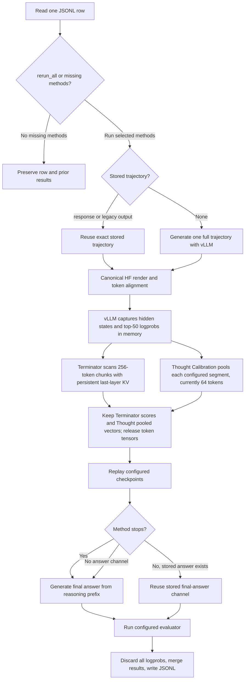

# Replay Eval v2

For the detailed GPU handoff, validation sequence, known integration risks,
and prioritized TODO list, see [`GPU_TESTING.md`](GPU_TESTING.md).

Replay Eval v2 runs the repository's existing early-exit methods over one
canonical Hugging Face token stream while using one long-lived asynchronous
vLLM engine for full generation, probes, DTSR scoring, and final answers.
Everything in v1 remains the source of truth: v2 imports the existing
checkpoints, verifiers, stop rules, method factories, `Response`, and scoring
utilities rather than copying them.

## Quick workflow



## Before the first GPU run

The committed configuration is a handoff template, not a runnable extraction
implementation. Complete these items on the GPU host:

1. Use the `text2sql` conda environment and confirm that PyTorch sees CUDA and
   that the installed vLLM supports the selected Qwen model.
2. Put the Terminator checkpoint at
   `checkpoints/terminator/probe.pt` and the Thought Calibration deployment
   artifact at `checkpoints/thought_calibration/replay/qwen35_4b/`. The latter
   must contain `config.json` and `model.joblib`.
3. Replace `your_gpu_package.replay_v2.extract_trace` in
   [`scripts/config.yml`](../../scripts/config.yml) with an importable async
   callback. With the configured hidden-state methods, it must return actual
   assistant-token `pre_final_rmsnorm` states. Generic vLLM token embeddings
   are deliberately rejected.
4. Set `agent_kwargs.replay_eval.version: 2` when using the common runner.
   Direct `python -m replay_eval.v2` invocation always selects v2.
5. Verify `mtp` is supported by the installed vLLM build and selected model.
   If not, remove `llm.vllm.serving.speculative_config` for the initial
   smoke test.

Record `torch`, vLLM, Transformers, CUDA, and driver versions before tuning;
the extraction and speculative-decoding APIs are version-sensitive.

## Configuration

`scripts/config.yml` is the only runtime YAML. Select the implementation at:

```yaml
agent_kwargs:
  replay_eval:
    version: 2  # 1 = existing replay, 2 = asynchronous native-vLLM replay
    v2:
      runtime:
        rerun_all: false  # true = rerun all; false = run only missing methods
        example_timeout_seconds: 300  # warn and skip after 5 minutes
        ...
      extraction: ...
      methods: ...

llm:
  vllm:
    dtype: bfloat16
    max_logprobs: 50
    tensor_parallel_size: 1
    gpu_memory_utilization: 0.9
    serving: ...  # shared prefix-cache and continuous-batching tuning
  models:
    qwen35_4b:
      # Existing id, chat template, completion settings, etc.
      vllm: {}  # Optional model-specific overrides
```

The required `--model` key selects the existing `llm.models` mapping, so its
model ID, thinking tokens, Hugging Face template arguments, temperature,
total-token budget, temporary-answer budget, and final-answer budget are not
duplicated.
The shared `agent_kwargs.replay_eval.code_probe_token_multiplier` and
`code_threshold_multiplier` values also apply to both versions. Common native
engine settings such as dtype, tensor parallelism, and GPU utilization live in
`llm.vllm`. The selected model's optional `vllm` mapping may override those
defaults one key at a time.
Shared GPU serving optimization lives at `llm.vllm.serving`. Replay v2
passes that mapping directly to `AsyncLLM`; the supplied config enables prefix
caching, chunked prefill, up to 4 continuously batched sequences, and a
2048-token batch ceiling. Hidden capture stores raw and normalized states in
addition to the normal prefill workspace, so this conservative ceiling avoids
large transient allocations on 32 GiB cards. A selected model can override any serving value in
its `vllm.engine_kwargs` or `vllm.serving` mapping.
The committed Qwen 3.5 entries avoid FlashAttention by setting
`attention_config.backend: TRITON_ATTN` and `gdn_prefill_backend: triton` under
their model-specific `vllm.engine_kwargs`. FlashInfer sampling is a separate
kernel path; `llm.vllm.environment.VLLM_USE_FLASHINFER_SAMPLER: "0"` disables
it before vLLM is imported. MTP is disabled for these entries because its
separate drafter can auto-select FlashAttention independently of the target
model. Change or remove those keys to select different backends.
V2 resolves one ordered method union: every uncommented entry in
`agent_kwargs.replay_eval.methods` first, followed by the v2-only Terminator and
Thought Calibration entries in
`agent_kwargs.replay_eval.v2.methods`. Duplicate configured names are rejected.
The committed config therefore resolves exactly 22 active methods. DoLa extraction and its disagreement
method are disabled in the committed config.

## Input and output

V2 reads JSONL. Each line must be a JSON object containing one of `problem`,
`question`, `prompt`, or `input`. Start with one short record:

```json
{"id":"smoke-1","question":"What is 17 + 25?"}
```

If no trajectory is supplied, v2 generates the full trace before replaying it.
An input may instead include an existing `response` dictionary and matching
`output_token_ids`. In that case, `response.input` must tokenize exactly like
the canonical Hugging Face rendering; v2 rejects prompt or token drift.

Legacy runner rows containing top-level `output` are also accepted. V2 reuses
that text, canonically tokenizes it, and obtains its observed-token logprobs
during hidden-state extraction instead of regenerating the trajectory.

When `--dataloader` is supplied, v2 loads the complete selected split and
compares all one-based positions with integer `line_number`/`id` values in the
input. Every absent position—including leading, internal, and trailing gaps—is
added as a fresh record, so every configured method runs for it even when
`--rerun-all false` is used. Thus a 120-row dataloader with only positions
1–110 in the input automatically runs positions 111–120. Inputs without
explicit numeric positions are interpreted as a contiguous leading slice. All
newly written rows, including these recovered missing-trajectory rows, store the
selected config key in top-level `model` (for example,
`"model": "gpt_oss_20b_high"`). The resolved checkpoint ID remains separate
and is still used to initialize the engine.

V2 requests top-50 logprobs for in-memory replay calculations. It recursively
removes `logprobs` and `top_logprobs` from new output JSON, including copied
legacy rows and nested `response` objects.

### DoLa disagreement and intervention

`extraction.dola_layers` selects zero-based transformer blocks. During the
already-exclusive hidden extraction pass, the worker projects those block
outputs and the final normalized state through the same LM head and stores, for
every assistant token, each layer's Jensen-Shannon divergence, the maximum JSD,
and the dynamically selected layer. The `dola_disagreement` method logs the
current value, its causal change from the previous checkpoint, and all selected
layer values. Its default infinite threshold makes it diagnostic-only.

This implements the proposal's detector without generating a second answer.
The causal decoder is exposed as `replay_eval.v2.dola.DoLaDecoder`; it uses dynamic
maximum-JSD layer selection, DoLa's adaptive plausibility constraint, KV cache,
greedy or temperature sampling, and returns the chosen layer/JSD at every
generated token. It deliberately runs as a Hugging Face backend: vLLM's request
sampler receives only final logits, so coupling intermediate hook state to its
continuously batched request rows would not be a safe intervention. Native JSD
projection currently requires `tensor_parallel_size: 1`.

For the exact layer-selection rule, package layout, and normal-chat CLI, see
[`dola/README.md`](dola/README.md). A quick interactive run is:

```bash
python -m replay_eval.v2.dola --model Qwen/Qwen3-4B --layers auto
```

With `runtime.rerun_all: false` (or `--rerun-all false`), V2 reads prior results
from `method_results`, `additional_logs.method_results`, or the nested response,
runs only configured method names that are absent, and merges the results.
`true` reruns all 23 active methods in the shared-plus-v2 union and writes only
the new results. Prior replay containers (`additional_logs`, `method_results`,
nested response method results, and `v2_timing`) are discarded so an output row
never contains old and new replay logs together. `false` applies missing-method
selection against that same 23-method union and preserves prior method results in
the single top-level `method_results` list.
When `runtime.rerun_final_answer: true` (or `--rerun-final-answer true`), an
existing result with no `final_answer` is regenerated directly from its stored
trajectory and `position`. V2 does not rerun hidden extraction, verifier scans,
or train-based methods for those results. Fully missing method results still use
the normal replay path.
The output file is created before measured evaluation begins. Each completed row is
written and flushed immediately in completion order, without waiting for earlier
input rows. Each output line preserves the
input and adds:

- `response`: the full generated or supplied trajectory;
- `method_results`: stop decisions and method logs;
- `v2_timing`: per-example rendering, hidden extraction/loading/processing,
  Terminator, Thought Calibration, replay, and evaluator timing. Hidden
  processing includes probe preparation, so method phase times overlap it. It
  also records `llm_calls`, `llm_call_seconds`, and `avg_llm_call_seconds` for
  actual engine submissions; request-cache hits are excluded.

- `correct`: evaluator results for the trajectory and each method answer;
The process also prints aggregate throughput, latency, cache, engine-load,
warmup, peak-GPU-memory, `llm_calls`, and `avg_llm_call_seconds` metrics after
the output file is written.

When `example_concurrency` is greater than one, ordinary generation requests may
run concurrently on the shared engine. Hidden-state extraction is exclusive:
the runner waits for active generations, blocks new submissions, captures one
trace, removes the hooks, and then resumes concurrent generation. This prevents
overlapping `replay_v2_begin_hidden_capture` calls and capture contamination.
Long phases log hidden-extraction start/finish and final-answer progress every
30 seconds. Answer Coverage and Dynasor also log their collected answer,
stability/consistency state, cache reuse, score, and configured stop target.
Built-in replay checkpoints scan directly against token positions and character
offsets. The runtime constructs the growing `Response` prefix only when a
checkpoint fires, avoiding quadratic prefix/logprob copying between checkpoints.
Custom checkpoint callables retain the original full-prefix behavior.
`runtime.min_interval` limits each method to one accepted
checkpoint per configured number of generated tokens. The first checkpoint is
always accepted; later checkpoints must be at least `min_interval` tokens after
that method's last accepted checkpoint. Set it to `0` to disable the gate.
Each example's capture, probes, DTSR calls, and final answers use a unique vLLM
cache salt. Hidden capture therefore recomputes the complete trace for exact
hooks without clearing unrelated KV prefixes, and later requests for that
example can reuse the captured prefix.
Reasoning parsing uses the last complete configured thinking-end marker. If no
complete marker exists, a trailing partial marker is removed (`abc</thi` becomes
thinking `abc` for `</think>`). Checkpoint rendering is truncated immediately
before the last thinking-end marker emitted by the chat template.
Final-answer prompts reuse the already validated canonical source/output token
arrays and slice at each method position instead of re-rendering and tokenizing
the long trajectory for every method. `v2_timing.final_prompt_build_seconds`
reports this CPU preparation cost.

## Run

Run version 2 through the common runner (version 2 currently requires an input
JSONL):

```bash
bash scripts/run_eval.sh \
  --agent replay_eval \
  --model qwen35_4b \
  --input-file INPUT.jsonl \
  --output-file OUTPUT.jsonl
```

Or invoke the v2 module explicitly; this always runs v2 regardless of the
configured version switch:

```bash
python -m replay_eval.v2 \
  --config scripts/config.yml \
  --model qwen35_4b \
  --input-file INPUT.jsonl \
  --output-file OUTPUT.jsonl
```

The small positional wrapper is equivalent:

```bash
bash replay_eval/v2/scripts/run.sh \
  INPUT.jsonl OUTPUT.jsonl qwen35_4b
```

For the first run, use one record, `example_concurrency: 1`,
`max_concurrency: 2`, `max_num_seqs: 2`, and a small temporary total token
budget. After it succeeds, restore the configured token budget and increase
batching while watching peak GPU memory and p95 latency.

V2 supports `--resume` to use the output JSONL as its checkpoint, preserve
completed rows, and append only unfinished input records. `--resume-from PATH`
reads completed rows from a separate checkpoint and writes a complete new
output. Record-specific failures are logged and omitted so a later resume
retries them; fatal engine failures still stop the run. The shared runner does
not yet support `--reverse` or `--limit` when version 2 is selected. It also runs JSONL directly rather than invoking a
configured dataloader/evaluator. Configure asynchronous example parallelism
with `agent_kwargs.replay_eval.v2.runtime.example_concurrency`; `--num-thread`
is a version-1 setting.

The default native extraction connector asks the live engine for observed
top-50 prompt logprobs (`prompt_logprobs=50`) and token embeddings. Log-probs stay
in memory only and are removed recursively from output JSON. The installed vLLM
build must support the `token_embed` pooling task on the selected model. A
deployment-specific `FileExtractionConnector` can instead connect an extended
vLLM worker that writes raw layer-`num_hidden_layers` and final-normalized
tensors by setting `extraction.mode: callback` and a dotted
`extraction.callback` in the v2 config. Extraction files are loaded only for
the example lifetime and are removed in a `finally` block.

## DoLa, Terminator, and Thought Calibration

Both model families were trained on the tensor produced by
`replay_eval.hidden_states`: assistant-token backbone states captured at the
input of the base model's learned final RMSNorm/LayerNorm. This is called the
`pre_final_rmsnorm` contract in v2. It is neither a sentence embedding nor an
L2-normalized token embedding.

The generic native `token_embed` extractor reports the distinct
`vllm_token_embed` contract. Hidden-state stopping methods reject it instead of
silently producing invalid scores. Use callback extraction for these methods.
The callback and Terminator settings live under
`agent_kwargs.replay_eval.v2` in [`scripts/config.yml`](../../scripts/config.yml).

Terminator supports two inference paths:

- Load a Terminator artifact directory (its `config.json` selects the base
  model, probe architecture, dtype, and checkpoint weight file) through
  `terminator/terminator.py`, then scan the extracted
  `pre_final_rmsnorm` tensor once before replay. Source states remain on CPU and
  only one configured query chunk is transferred to the GPU at a time. The
  precompute phase uses a persistent
  Terminator KV cache: each token's K/V and classifier output are calculated
  once, while rectangular causal masks avoid materializing the full long-trace
  attention matrix. V2 keeps only the per-token probabilities needed to mimic
  rollout. Every 16 replay tokens, it reads the 9-token
  overlap plus 16 new scores (25 total), forms 16 rolling windows of length 10,
  and stops when any window's number of positive classifications is strictly
  greater than `threshold`. The first 16-token block has only the seven full
  windows ending at tokens 10 through 16. Because generation has already
  produced the block, a match in any of its windows stops at that block's
  16-token replay boundary. The default position
  mode is `assistant_relative`, matching the current `terminator/train.py`
  fallback: the extractor writes `position_ids`, while that collator currently
  looks for `positions`. Set `position_mode: absolute_prompt` only for a
  checkpoint known to have trained with the extractor's absolute positions;
  those begin at `ExtractionResult.prompt_tokens`.
- Run `terminator/terminator_vllm.py::VLLMTerminatorProbe` inside a custom vLLM
  model worker, where the split hidden/residual streams still exist. Return its
  per-token probabilities as `model_outputs.terminator`; v2 consumes those
  scores without reconstructing the split streams or loading a second probe.
  The same 25-score/16-window replay is applied to worker scores.

Thought Calibration loads its deployment `config.json` and `model.joblib` and
pools all configured `segment_mean` vectors before replay. Once Terminator and
Thought preparation finish, v2 releases the full raw and normalized token
tensors and deletes their temporary files. At checkpoints it calls the
tensor-only probe and reuses the unchanged moving-average implementation
from `thought_calibration/calibration.py`. Its selected LTT threshold is read
by risk tolerance. A `null` threshold becomes an infinite threshold, preserving
the artifact's full-budget fallback rule.

The callback result must add these fields to the ordinary extraction payload:

```python
{
    "hidden_state_contract": "pre_final_rmsnorm",
    "prompt_tokens": output_start,
    "model_id": "Qwen/Qwen3.5-4B",
    # Optional: output of VLLMTerminatorProbe, one value per output token.
    "model_outputs": {"terminator": [0.01, 0.02, ...]},
}
```

`raw_hidden_path` must contain `[T, H]` pre-final-norm states in the base
model's normal dtype. `normalized_hidden_path` remains required by the general
v2 extraction interface and must contain the learned final-normalized form.
Both tensors, `observed_logprobs`, every worker score stream, and
`output_token_ids` must have the same `T` token positions.

## What to notice during validation

- The configured callback placeholder fails at import time until replaced.
- `hidden_state_contract` must be `pre_final_rmsnorm` for Terminator and
  Thought Calibration. Do not relabel `vllm_token_embed` output to bypass this
  check; compare the tensors against `replay_eval.hidden_states` first.
- There must be one observed logprob and one hidden-state row per stored
  assistant output token. Alignment errors are fatal rather than truncated.
- Terminator's `threshold: 0.5` is a strict positive-count threshold, not a
  probability threshold. Since counts are integers, any 10-token window with
  at least one classification at or above `classification_threshold: 0.5`
  stops at the current 16-token replay boundary.
- Terminator uses assistant-relative position IDs by default because of the
  current training-field mismatch. Use absolute prompt positions only for a
  checkpoint trained with them.
- Thought Calibration's `check_every` must match the artifact's training
  segmentation. Changing it changes the pooled features and invalidates the
  calibrated threshold.
- Model loading and warmup are excluded from measured throughput. Do not treat
  the first warmup latency as an example latency.
- Prefix caching should produce cache hits for nearby probes. A zero hit ratio
  merits investigation before increasing concurrency.
- `max_logprobs: 50` is required only because ENTROCUT can request top-50. It
  increases logprob work; v2 requests top-50 only at ENTROCUT checkpoints.
- MTP speculative decoding is model- and vLLM-version-specific. First rerun
  without `speculative_config` if engine construction fails.
- Successful and failed examples should leave no extraction `.pt` files in
  `/tmp/replay-v2-extraction`.

## Behavioral guarantees

- GPT-OSS assistant messages use separate `thinking` and `content` fields;
  unfinished checkpoints pass `continue_final_message="thinking"`.
- Normal probes are deduplicated at a checkpoint using the largest requested
  token/logprob budget. DTSR uses a separate exact-token request key.
- Request keys contain rendered token IDs, sampling parameters, checkpoint,
  probe kind, and rollout slot. A full answer never aliases a temporary answer.
- ENTROCUT always uses the existing `EntrocutVerifier` with top-50 candidates;
  `max_logprobs` below 50 is rejected.
- Warmup and model loading are reported separately from measured throughput.

## Tests

The suite requires no GPU or vLLM installation:

```bash
python -m unittest discover -s replay_eval/v2/tests -v
```

## Continue after confirmed exits

Set shared `agent_kwargs.replay_eval.exit: false` (standalone config:
`runtime.exit: false`), or pass `--exit false`. All enabled methods keep checking
after each confirmed exit, saving `method:1`, `method:2`, ... and a terminal
`method:full` result. The default `true` preserves first-exit behavior.
See [continued replay and naming rules](../README.md#continue-after-confirmed-exits-trap-analysis-samples)
for metadata, checkpoint numbering, and incremental replay behavior.
